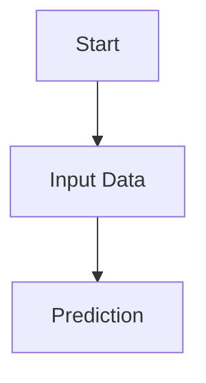

# MkDocs Documentation Template


A reusable [MkDocs](https://www.mkdocs.org/) + [Material for MkDocs](https://squidfunk.github.io/mkdocs-material/) template for educational and technical documentation (Java, C, C++, Python, JavaScript, ML, …).

Features: System/Light/Dark themes, search, breadcrumbs, prev/next, copy-button code blocks, MathJax (LaTeX), Mermaid diagrams, admonitions, tabs, responsive layout.

See `PRD.md` (requirements), `TECHNICAL_DESIGN.md` (design), and `VALIDATION_REPORT.md` (what was actually tested).

## Install (Windows PowerShell)

```powershell
python -m venv .venv
.venv\Scripts\Activate.ps1
pip install -r requirements.txt
```

macOS/Linux: `python3 -m venv .venv && source .venv/bin/activate && pip install -r requirements.txt`.

Tested with Python 3.14.8; the dependency ranges are intended to work on Python 3.12+ (3.12 itself was **not** tested).

## Local development

```powershell
mkdocs serve              # http://127.0.0.1:8000 with live reload
mkdocs build --strict     # build to site/; fails on broken links/warnings
```

Material 9.7 prints a boxed "MkDocs 2.0" notice on every build. It is an upstream announcement, not a project warning, and does not fail `--strict`. `requirements.txt` caps `mkdocs<2`.

## Project layout

```
mkdocs.yml                 site identity, theme, nav, extensions, assets
requirements.txt
docs/                      all published content
  index.md, getting-started/, curriculum/, authoring/, examples/
  stylesheets/extra.css    small theme-aware overrides
  javascripts/mathjax.js          MathJax config
  javascripts/mermaid-config.js   Mermaid options (security, theme CSS)
  assets/vendor/mermaid/   vendored, pinned Mermaid (+ LICENSE, VERSION.txt)
examples/                  source files NOT published; include with snippets
```

## Writing content

**New page:** create `docs/<section>/<name>.md` starting with one `# Title`, then add it to `nav:` in `mkdocs.yml`.

**Navigation:** edit `nav:`. A folder with `index.md` becomes a section landing page.

```yaml
nav:
  - Home: index.md
  - Java Basics:
      - java/index.md
      - Variables: java/variables.md
```

**Code:** fenced blocks with a language; add `title="..."`, `linenums="1"`, `hl_lines="2"`. Copy buttons are automatic. Include files from `examples/` with `--8<-- "programming/hello.py"` (path relative to `examples/`).

**Tabs, admonitions, tables:** see `docs/authoring/components.md` and `docs/authoring/code.md`.

**Math (MathJax):** `$...$` or `\(...\)` inline; `$$...$$` or `\[...\]` display; `aligned`, matrices etc. work. See `docs/authoring/math.md`. A literal dollar sign is `\$`. Limitations: MathJax loads from `cdn.jsdelivr.net` (pinned 3.2.2), so **math needs network access**; offline use is not provided (you could vendor `tex-mml-chtml.js` into `docs/assets/` and point `extra_javascript` at it, but that is untested).

**Mermaid diagrams:**

````markdown

````

Supported (verified in `docs/examples/mermaid.md`): flowchart, sequence, class, state, ER, Gantt, pie, Git graph, mindmap. Mermaid 11.17.2 is vendored in `docs/assets/vendor/mermaid/`, so diagrams need no network. Mermaid runs with `securityLevel: "strict"`; diagrams follow the Light/Dark palette. To upgrade: `npm pack mermaid@<version>`, copy `package/dist/mermaid.min.js` and `LICENSE` over the vendored files, update `VERSION.txt`. Limitations: a malformed diagram stays as source text in its own block and logs a console error; Gantt/sequence text is small on phones; Git-graph branch label colours are only adjusted for the first two branches.

## Themes

The header has one button that cycles **System → Light → Dark** (Material's native palette, configured in `mkdocs.yml` under `theme.palette`). The choice is remembered in the browser. Colours: change `primary`/`accent`. Custom CSS must use `var(--md-*)` variables.

## Create a new subject (Java, C, C++, …)

1. Copy or clone this folder into a new repository (for example `java-course`), and delete `.git` if copying.
2. In `mkdocs.yml` set `site_name`, `site_description`, `site_url`, `repo_url`, `repo_name`, and (optionally) palette colours.
3. Replace `docs/curriculum/` and the `nav:` entries with your chapters. Keep or delete `docs/authoring/` and `docs/examples/` (they are reference pages).
4. Put your own sample sources in `examples/` if you use snippets.
5. `pip install -r requirements.txt`, `mkdocs serve`, then `mkdocs build --strict`.

## Deploy to GitHub Pages

1. Create the GitHub repository and push this project to `main`.
2. Set `site_url` to `https://<user>.github.io/<repo>/` (project site) and `repo_url` to the repository. `site_url` is the canonical URL used for sitemap and links.
3. Run `mkdocs gh-deploy --strict`. It builds the site and pushes it to the `gh-pages` branch.
4. In GitHub: **Settings → Pages → Build and deployment → Deploy from a branch → `gh-pages` / root**.
5. The site appears at the `site_url`. Asset paths are relative, so the sub-path works. No custom domain is assumed.

Nothing in this repository has been deployed.

## Demo

* https://topekox.github.io/mkdocs-template/

## Runtime network dependencies

| Dependency | When | Notes |
|---|---|---|
| `cdn.jsdelivr.net` (MathJax 3.2.2) | every page | needed for equations |
| `api.github.com` | every page, if `repo_url` is set | Material shows repository info in the header; remove `repo_url` to avoid it |
| Google Fonts | never | `theme.font: false` uses system fonts |
| Mermaid | never | vendored |

## License

Released under the [MIT License](LICENSE). The vendored Mermaid library in `docs/assets/vendor/mermaid/` is also MIT-licensed and keeps its own `LICENSE` file. When you copy this template for a new subject, update the copyright holder in `LICENSE`.
