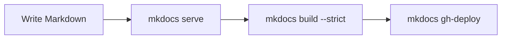

# Components

## Admonitions

!!! note
    A neutral note.

!!! tip "Tip"
    A helpful hint.

!!! warning
    Something to watch out for.

!!! danger
    Destructive or risky.

??? info "Collapsible"
    Hidden until clicked.

## Tables

| Language | Typing | Compiled | Typical use |
|---|---|---|---|
| Java | Static | Bytecode (JVM) | Enterprise, Android |
| C | Static | Native | Systems, embedded |
| C++ | Static | Native | Games, performance-critical software |
| Python | Dynamic | Interpreted | Scripting, data science, ML |
| JavaScript | Dynamic | JIT | Web |

## Diagram

## Other

Keyboard keys: ++ctrl+c++. Highlighted: ==important==.

Term
:   Definition list entry.

Footnote example.[^1]

[^1]: Footnotes appear at the bottom of the page.
