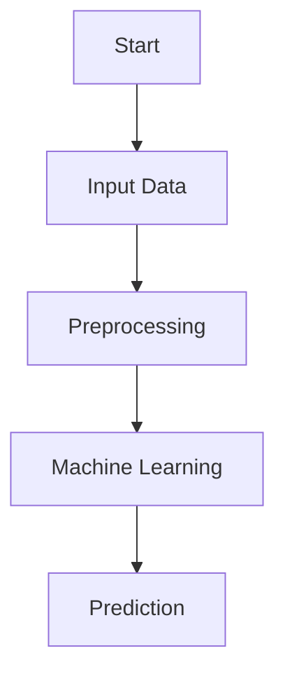
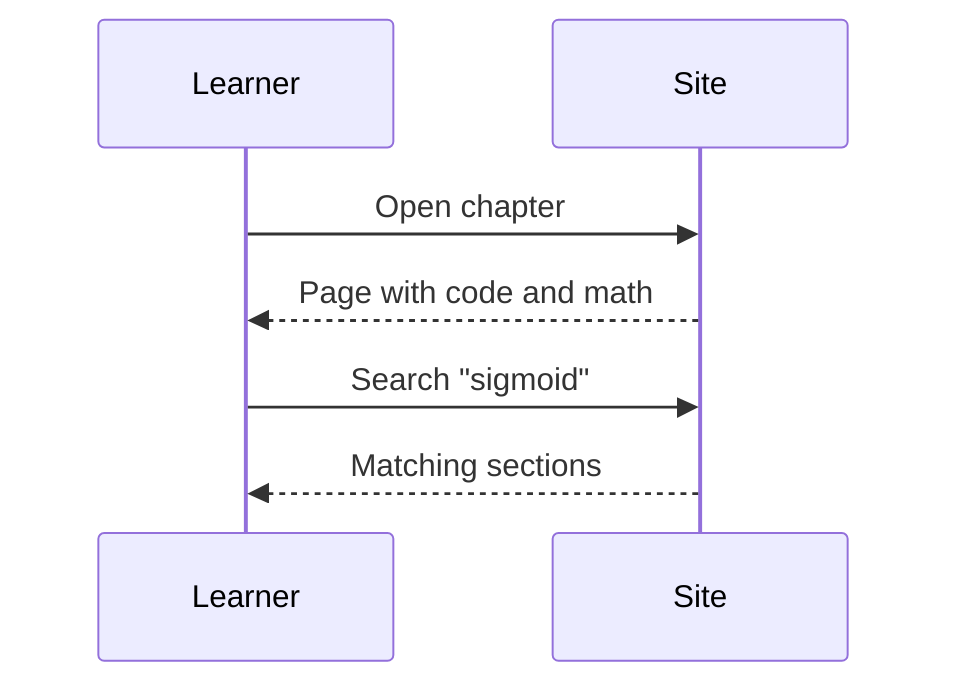
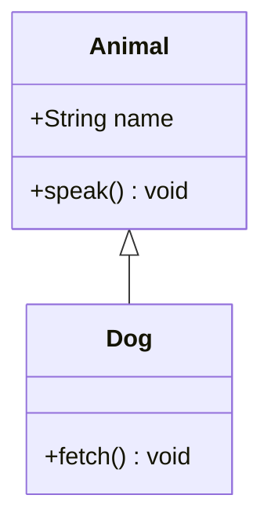
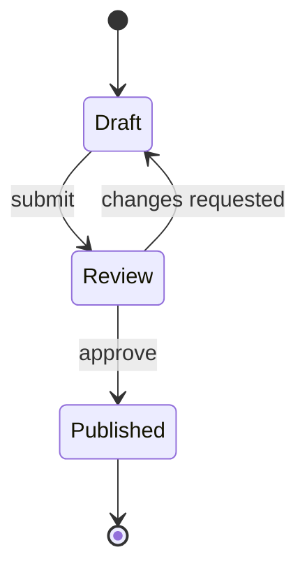
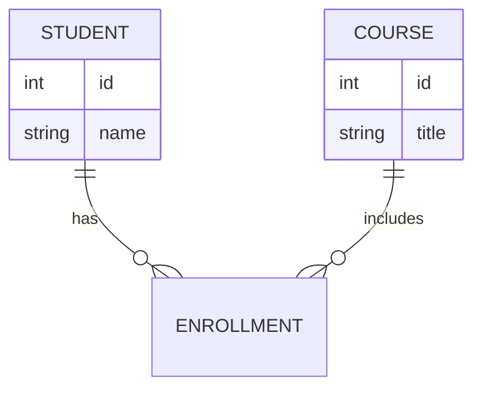
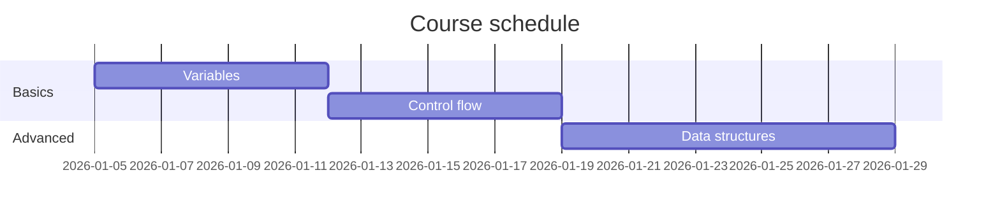
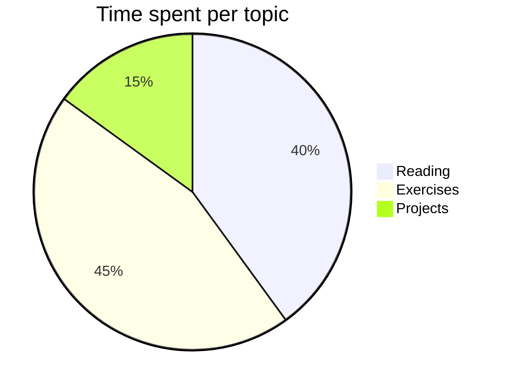
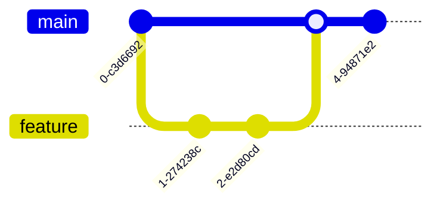
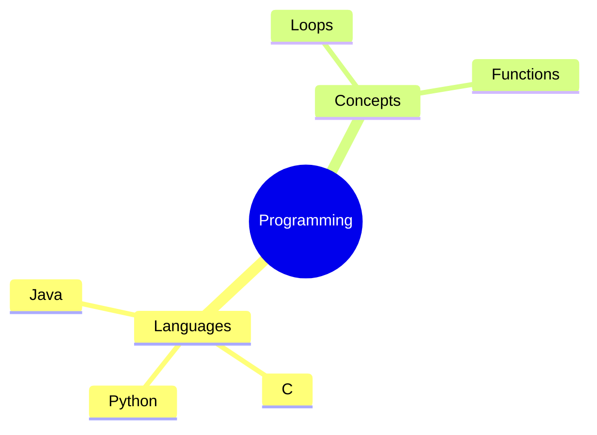

# Mermaid Diagrams

Write a fenced block with the `mermaid` language. Diagrams follow the active
Light/Dark theme automatically.

## Flowchart



## Sequence diagram



## Class diagram



## State diagram



## Entity relationship diagram



## Gantt chart



## Pie chart



## Git graph



## Mindmap



## Malformed diagram

An invalid diagram shows an error in its own block; the rest of the page is unaffected.

```mermaid
flowchart TD
    A[Start --> ???
```

## Notes

- Mermaid is vendored at `docs/assets/vendor/mermaid/` (pinned version, MIT) and
  needs no network access.
- Mermaid runs with its default `strict` security level.
- Diagram source is plain text in the generated HTML until JavaScript renders it.
